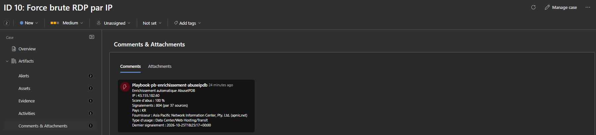
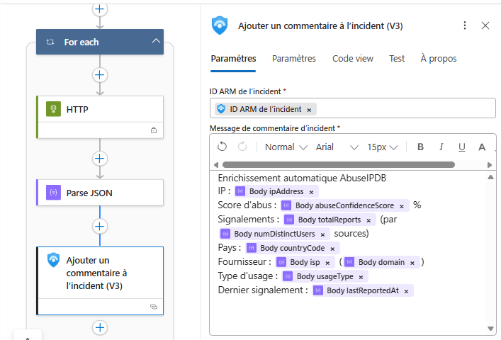
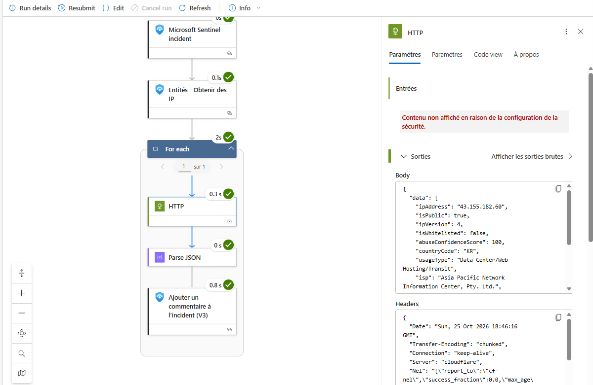
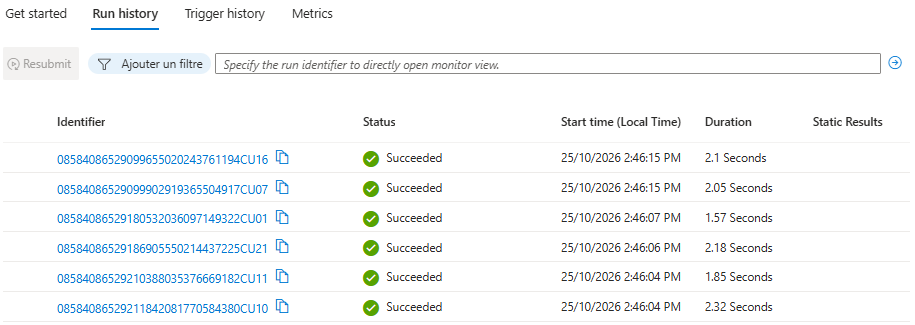
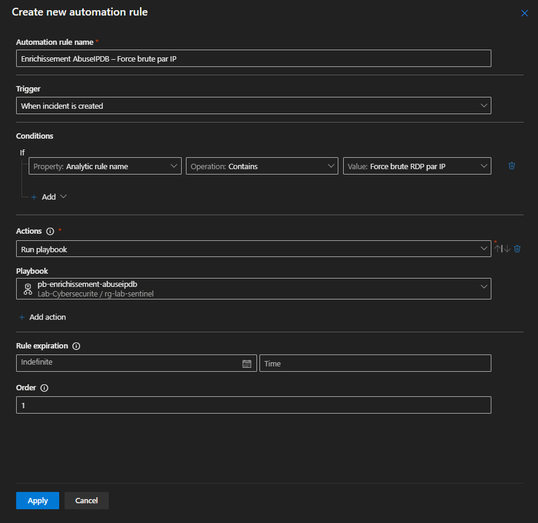

# Lab 02 – Automatisation de la réponse (SOAR) avec Microsoft Sentinel

> **English summary:** SOAR lab. I built a Microsoft Sentinel playbook (Azure Logic Apps) that automatically enriches every brute-force incident: it extracts the attacker IPs, queries the AbuseIPDB API and writes the reputation (abuse score, reports, country, ISP, usage type) as a comment on the incident. The playbook authenticates with a **managed identity** under the **least-privilege** role *Microsoft Sentinel Responder*, and the API key is protected with **secure inputs**. Each run takes about 2 seconds — work that took several minutes per IP by hand in Lab 01.

## Résultats en bref
| Mesure | Valeur |
|---|---|
| Incidents enrichis automatiquement pendant le test | 6 |
| Exécutions du playbook réussies | 6 sur 6 |
| Durée d'une exécution | 1,6 à 2,3 secondes |
| Exemple d'IP enrichie | 43.155.182.60 : score d'abus 100 %, 804 signalements par 37 sources |
| Clé d'API visible dans l'historique | Non (entrées sécurisées) |



## Le problème
Dans le laboratoire 1 (lab01-sentinel-rdp-bruteforce), j'ai enrichi chaque IP **à la main** sur AbuseIPDB : quelques minutes par IP, pour 96 IP. Un SOAR (*Security Orchestration, Automation and Response*) automatise ces tâches répétitives pour que l'analyste se concentre sur l'analyse.

## Architecture
```
Attaque RDP (pot de miel du lab 1)
      │
Règle analytique « Force brute RDP par IP » ── entités IP + Host ──► Incident
      │
Règle d'automatisation (« quand un incident est créé », condition : nom de la règle)
      │
Playbook pb-enrichissement-abuseipdb (Azure Logic Apps, identité managée)
   1. Entités – Obtenir les IP
   2. Pour chaque IP :
        HTTP GET → API AbuseIPDB /api/v2/check   (entrées sécurisées)
        Analyser JSON
        Ajouter un commentaire à l'incident (V3)
```



## Outils et technologies
Microsoft Sentinel · Portail Microsoft Defender · Azure Logic Apps · Identité managée (Microsoft Entra ID) · Azure RBAC · API REST AbuseIPDB · JSON · KQL

## Étapes réalisées
1. **Règle analytique par IP** : regroupe les échecs par `IpAddress` et `Computer`, mappe les entités **IP** et **Host**, une alerte par résultat, regroupement des alertes d'une même IP sur 5 heures. Détails : [`regles/`](regles/).
2. **Playbook** créé à partir du modèle *Playbook with incident trigger*, connecté à Sentinel par **identité managée**.
3. **Sécurité du playbook** :
   - rôle **Microsoft Sentinel Responder** sur le groupe de ressources uniquement (moindre privilège) ;
   - **entrées sécurisées** sur l'action HTTP : la clé d'API n'apparaît pas dans l'historique.
4. **Autorisations de playbook** de Sentinel limitées au groupe de ressources du laboratoire.
5. **Règle d'automatisation** qui lance le playbook seulement pour les incidents de la règle « par IP ».
6. **Test** : seuil abaissé temporairement à 2 tentatives pour générer des incidents, puis remis à 20.





## Difficultés rencontrées et solutions
| Difficulté | Cause | Solution |
|---|---|---|
| Le playbook n'apparaissait pas dans la règle d'automatisation | Créé avec un déclencheur « alerte », puis modifié à la main ; Sentinel le classait comme « Action » | Recréé avec le modèle *Playbook with incident trigger* ; vérifié que le type affiché est « Microsoft Sentinel Incident » |
| Aucun incident « par IP » ne se créait | Le botnet faisait au plus 3 tentatives par IP et par heure, sous le seuil de 20 | Seuil abaissé à 2 le temps du test, puis remis à 20 |
| Commentaire absent de la nouvelle vue *Cases* | Délai d'affichage de l'interface | Preuve trouvée en KQL dans la table `SecurityIncident` (colonne `Comments`), puis affichage dans le cas quelques minutes plus tard |

## Ce que j'ai appris
- **Automatiser l'enrichissement** fait passer le triage de plusieurs minutes à quelques secondes par IP.
- **Le type de déclencheur compte** : seuls les playbooks à déclencheur *incident* peuvent être lancés par une règle d'automatisation sur incident.
- **Moindre privilège** : le playbook peut commenter les incidents, mais pas modifier les règles ni la configuration.
- **Protéger les secrets** : entrées sécurisées dans Logic Apps ; en production, la clé serait stockée dans **Azure Key Vault** et lue par l'identité managée.
- **Une exécution « réussie » ne prouve pas le résultat** : j'ai vérifié chaque étape de l'exécution et le contenu réellement écrit dans l'incident.
- **On valide une automatisation avec un seuil bas**, puis on revient au seuil de production.

## Pistes d'amélioration
- Lire la clé d'API depuis Azure Key Vault.
- Relever la gravité de l'incident ou ajouter une étiquette quand le score d'abus est de 100 %.
- Bloquer automatiquement l'IP dans le NSG (confinement), avec approbation de l'analyste.

## Contenu du dépôt
| Dossier | Contenu |
|---|---|
| [`playbook/`](playbook/) | Structure du playbook, schéma JSON et message du commentaire |
| [`regles/`](regles/) | Règle analytique par IP et règle d'automatisation |
| [`captures/`](captures/) | Captures d'écran |

## Avertissement
Environnement de laboratoire personnel. La clé d'API n'est publiée nulle part dans ce dépôt.
