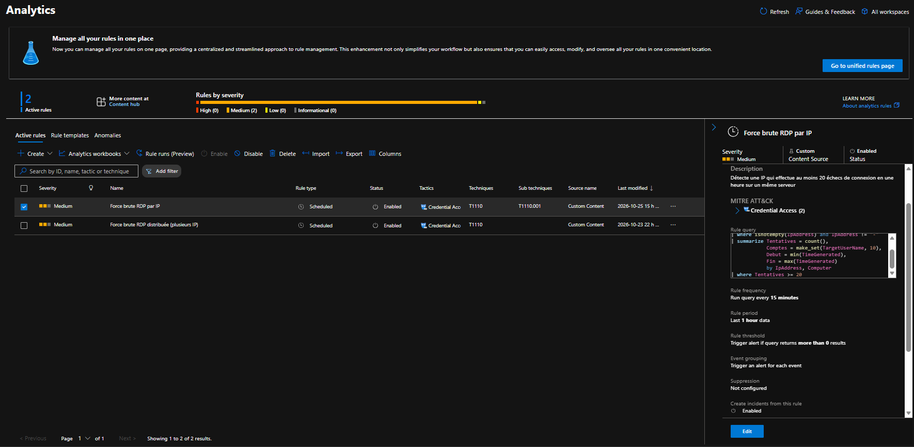

# Règle analytique – Force brute RDP par IP

| Paramètre | Valeur |
|---|---|
| Gravité | Moyenne |
| MITRE ATT&CK | Credential Access – T1110, T1110.001 |
| Fréquence | Toutes les 15 minutes, sur la dernière heure |
| Seuil | Plus de 0 résultat |
| Entités | IP → Address → `IpAddress` · Host → HostName → `Computer` |
| Regroupement des événements | Une alerte par résultat |
| Regroupement des alertes | 5 heures, si toutes les entités correspondent |

```kql
SecurityEvent
| where EventID == 4625
| where isnotempty(IpAddress) and IpAddress != "-"
| summarize Tentatives = count(),
            Comptes = make_set(TargetUserName, 10),
            Debut = min(TimeGenerated),
            Fin = max(TimeGenerated)
            by IpAddress, Computer
| where Tentatives >= 20
```

Pendant le test, le seuil a été abaissé à 2 pour générer des incidents, puis remis à 20.

Pourquoi deux entités : l'IP répond à « qui attaque ? » et sert au playbook ; le Host répond à « qu'est-ce qui est attaqué ? » et permet la corrélation avec d'autres alertes sur la même machine.


